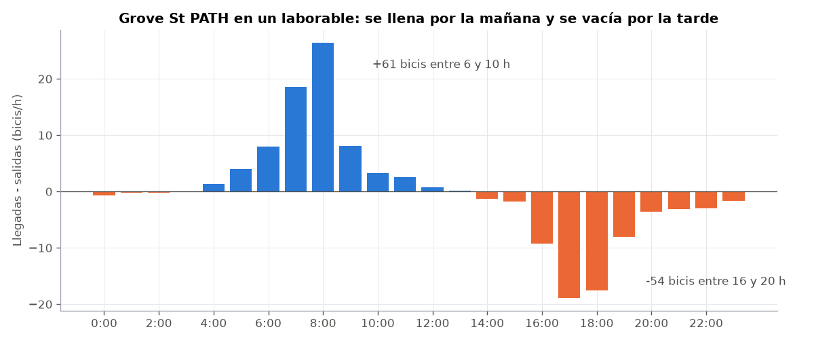
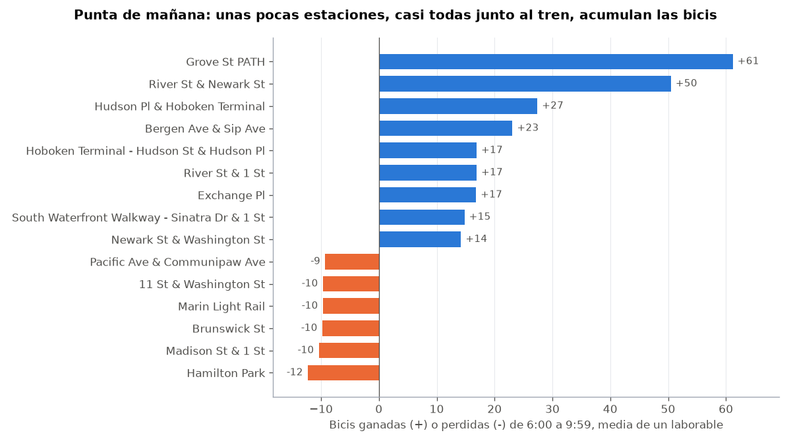
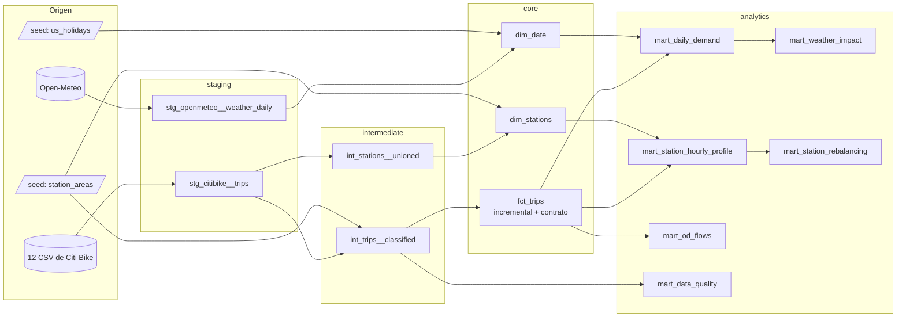
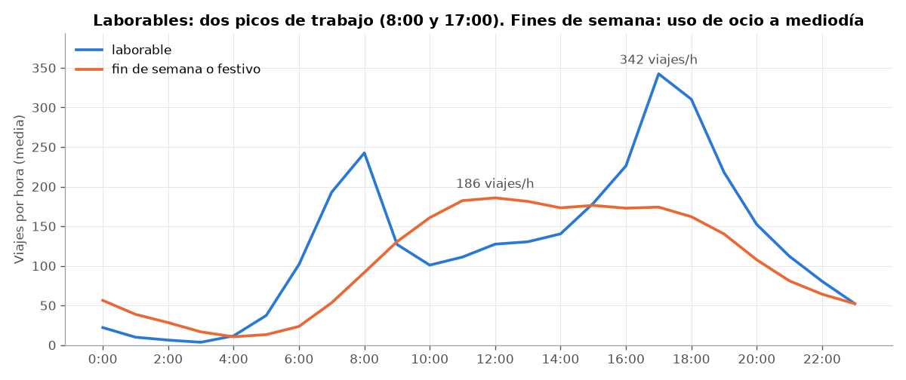
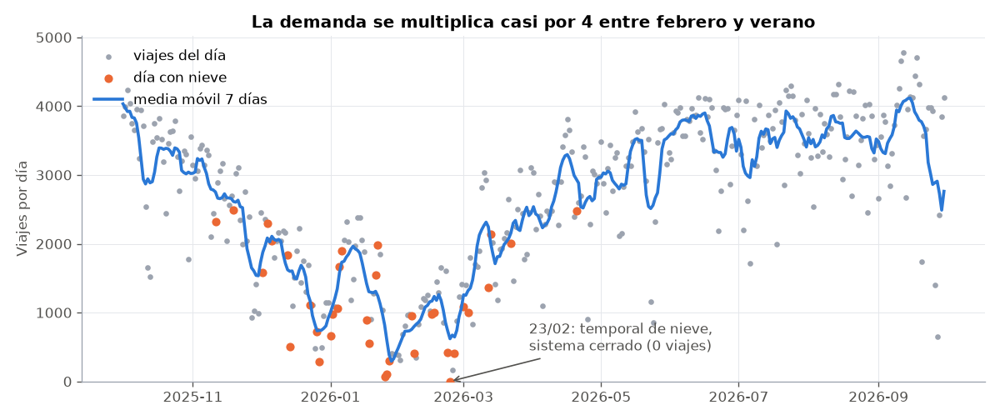
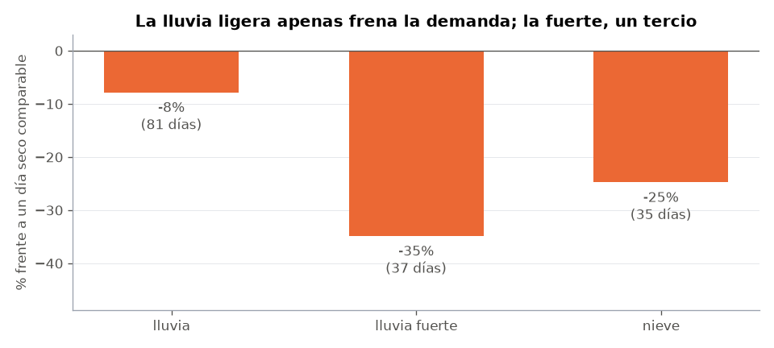

# Citi Bike Jersey City — pipeline de datos con dbt

**Pipeline de *analytics engineering* con dbt + DuckDB que transforma 972.000 viajes reales de bici compartida y la meteorología diaria en un modelo en estrella probado, documentado y listo para analizar.**

### 🔗 [Ver la documentación interactiva y el grafo de linaje (demo)](https://alvarodc093-pixel.github.io/CitiBike-dbt-Analytics/)

[](https://github.com/alvarodc093-pixel/CitiBike-dbt-Analytics/actions/workflows/ci.yml)    



## En resumen

- **Problema:** un sistema de bici compartida tiene que saber cuánta demanda habrá, qué la frena y, sobre todo, **dónde se acumulan las bicis y dónde faltan**: el reparto con camiones es su mayor coste operativo. Para responderlo hace falta primero un modelo de datos limpio, probado y documentado, que es el objetivo de este proyecto.
- **Datos:** 12 meses (octubre de 2025 a septiembre de 2026) de [viajes de Citi Bike en Jersey City y Hoboken](https://citibikenyc.com/system-data), 12 CSV mensuales, más la meteorología diaria de [Open-Meteo](https://open-meteo.com/).
- **dbt:** 14 modelos en cuatro capas (staging → intermediate → core → analytics), un hecho **incremental** con **contrato de datos**, **61 tests** (59 de datos y 2 de cuadre entre capas) y un **unit test** con 8 casos. Además, macros propias, *seeds*, variables de proyecto, *exposures* y documentación publicada en GitHub Pages en cada push.
- **Resultado:** 9 estaciones, casi todas junto al tren, acumulan **~240 bicis cada mañana laborable** y las devuelven por la tarde. La lluvia fuerte resta **un 35 %** de los viajes y la nieve **un 25 %**. El 99,4 % de las filas de origen son válidas, y cada fila descartada tiene su motivo registrado.

## Hallazgos

| # | Pregunta | Respuesta corta | Modelo |
|---|---|---|---|
| 1 | ¿Cuándo se usa la bici? | Los laborables tienen dos picos de trabajo: **8:00 (243 viajes/h)** y **17:00 (342 viajes/h)**. El fin de semana no hay picos: una meseta de ocio de 11 a 18 h. Un laborable medio tiene 2.814 viajes y un día de fin de semana, 2.323. | [`mart_station_hourly_profile`](models/marts/analytics/mart_station_hourly_profile.sql) |
| 2 | ¿Dónde se acumulan las bicis? | El balance del día engaña: casi todas las estaciones parecen "equilibradas" porque lo que entra por la mañana sale por la tarde. Por horas, **Grove St PATH gana 61 bicis de 6 a 10 h y pierde 54 de 16 a 20 h**. Lo mismo, a menor escala, en otras 8 estaciones, la mayoría junto a Hoboken Terminal, Exchange Pl o Journal Square. Entre las 9 suman **~240 bicis** cada mañana. | [`mart_station_rebalancing`](models/marts/analytics/mart_station_rebalancing.sql) |
| 3 | ¿Cuánto frena la meteorología? | Frente a un día seco del mismo mes y tipo de día: lluvia ligera **−8 %**, nieve **−25 %** y lluvia fuerte (≥ 10 mm) **−35 %**. El 23 de febrero de 2026 un temporal cerró el sistema: **0 viajes**. | [`mart_weather_impact`](models/marts/analytics/mart_weather_impact.sql) |
| 4 | ¿Cuánto pesa la estacionalidad? | De **907 viajes/día en febrero a 3.569 en verano**: casi 4 veces más. | [`mart_daily_demand`](models/marts/analytics/mart_daily_demand.sql) |
| 5 | ¿Quién usa el sistema? | El **77 %** de los viajes son de abonados, con viajes cortos y de rutina (mediana de 5,7 min). Los ocasionales hacen viajes más largos (8,1 min) y pasan del 20 % de los viajes en laborable al **32 % en fin de semana**. El **64 %** de los viajes son en bici eléctrica. | [`fct_trips`](models/marts/core/fct_trips.sql) |
| 6 | ¿Se mueve la gente entre ciudades? | El 12 % de los viajes van de Jersey City a Hoboken o al revés. Solo 3.048 (0,3 %) cruzan el río hasta Manhattan, a 384 estaciones distintas. | [`mart_od_flows`](models/marts/analytics/mart_od_flows.sql) |
| 7 | ¿Qué calidad tienen los datos? | De 972.092 filas, **966.462 son viajes válidos (99,4 %)**. Se descartan 5.024 sin estación de destino, 561 de más de 24 h, 18 duplicados, 16 de fuera del periodo, 7 de duración negativa y 4 sin estación de origen. | [`mart_data_quality`](models/marts/analytics/mart_data_quality.sql) |



## Recomendaciones de negocio

1. **Planificar el reparto por horas, no por días.** Un informe diario diría que el sistema está equilibrado. El camión tiene que vaciar Grove St PATH, Hoboken Terminal y River St & Newark St **antes de las 9:00** y volver a llenarlas **antes de las 16:00**.
2. **Ampliar los anclajes de las estaciones de tren en lugar de mover bicis.** Más anclajes en Grove St PATH reducen las veces que hay que vaciarla con camión en plena hora punta. Una estación llena a las 8:30 deja sin sitio a quien viene a coger el tren y se pierde ese cliente.
3. **Usar la previsión del tiempo para dimensionar la plantilla.** Un día de lluvia fuerte tiene un tercio menos de viajes: menos reparto y buen momento para el mantenimiento. Tras una nevada la demanda tarda varios días en recuperarse.
4. **Convertir a los ocasionales del fin de semana en abonados.** Hacen viajes más largos, sobre todo en eléctrica, y el fin de semana pasan del 20 % al 32 % de los viajes. Una oferta de primer mes de abono tras su segundo viaje de fin de semana es el embudo natural.

## Cómo está montado



| Capa | Materialización | Qué hace |
|---|---|---|
| `staging` | vista (y tabla en `stg_citibike__trips`) | Renombra, fija tipos y elimina duplicados. No descarta ningún viaje: eso se decide después, para poder contarlo. |
| `intermediate` | vista | Reglas de negocio. `int_trips__classified` es el **único** sitio donde se decide qué viaje es válido, así que la tabla de hechos y la de calidad siempre cuadran. |
| `core` | tabla / incremental | Modelo en estrella. `fct_trips` es incremental y tiene **contrato**: si una columna cambia de tipo o de nombre, dbt falla al construirla en vez de romper los informes. |
| `analytics` | tabla | Una tabla por pregunta de negocio, que leen los gráficos (declarados como *exposure*). |

### Calidad: qué prueba cada test

| Tipo | Ejemplos |
|---|---|
| **Genéricos de dbt** | `unique` y `not_null` en cada clave, `accepted_values` en categorías y `relationships` de los hechos con sus dimensiones. |
| **Genéricos propios** ([`tests/generic`](tests/generic)) | `accepted_range` (duración entre 60 s y 24 h, coordenadas dentro del área, hora entre 0 y 23), `unique_combination` (grano de las tablas agregadas) e `is_complete_date_spine` (que no falte ningún día). Escritos a mano, sin depender de `dbt_utils`. |
| **Singulares de cuadre** ([`tests/singular`](tests/singular)) | Filas del CSV = duplicados + válidos + excluidos por motivo. Las tablas de analytics suman lo mismo que `fct_trips`. |
| **Unit test** | [`clasifica_cada_motivo_de_exclusion`](models/intermediate/_intermediate.yml): 8 viajes inventados, uno por cada caso límite (59 s, 60 s, sin destino, de diciembre, a Manhattan…), con el resultado esperado. |
| **Aviso, no error** | Si un fichero mensual baja del 95 % de filas válidas, el test avisa (`severity: warn`) para revisarlo sin bloquear la carga. |
| **Incremental = completa** | El CI carga hasta agosto, añade septiembre en modo incremental y comprueba fila a fila que el resultado es idéntico a una carga completa ([`comprobar_incremental.py`](comprobar_incremental.py)). |

### Decisiones y trampas evitadas

- **Duplicados entre ficheros.** Un viaje que empieza el 30 de abril a las 23:56 y termina el 1 de mayo aparece en los ficheros de los dos meses. Se eliminan con `QUALIFY ROW_NUMBER()` sobre `ride_id`.
- **Filtrar por fecha, no por fichero.** El fichero de octubre trae 16 viajes de septiembre. El periodo se define con variables del proyecto (`periodo_inicio`, `periodo_fin`).
- **Leer todo como texto y fijar los tipos en staging.** Los id de estación de Nueva York son numéricos (`5329.03`) y los de Jersey City no (`JC115`). Si se deja que DuckDB detecte los tipos, un mes podría leerse distinto que otro.
- **El calendario no sale de los viajes.** `dim_date` se genera con una serie de fechas. Si saliera de los viajes, el 23 de febrero (0 viajes por el temporal) simplemente no existiría y la media de febrero saldría inflada.
- **Comparar la lluvia con días comparables.** Llueve y nieva más en invierno, cuando ya se usa menos la bici. Cada día se compara con los días secos del **mismo mes y tipo de día**. Comparando todos los días a la vez, la nieve parecería restar el 58 %.
- **Las medias por estación, sobre los días que existía.** Hudson Pl & Hoboken Terminal abrió el 31 de julio. Dividiendo entre el año entero (250 laborables en lugar de 43), su desequilibrio saldría casi 6 veces más pequeño.
- **Nombres de estación cambiantes.** JC118 aparece con dos nombres ("Pacific Ave & Communipaw Ave" y al revés). `dim_stations` usa el más reciente y guarda cuántos ha tenido.
- **Una regla que no salta también informa.** El filtro de falsos arranques (< 60 s, el criterio de Citi Bike) no descarta ningún viaje porque Citi Bike ya los quita antes de publicar. Se mantiene como salvaguarda, y la tabla de calidad lo hace visible.

## Más gráficos







## Cómo ejecutarlo

```bash
pip install -r requirements.txt
python descargar_datos.py     # ~35 MB: 12 meses de Citi Bike + meteorología
dbt build                     # construye los 14 modelos y ejecuta todos los tests
python graficos.py            # regenera docs/img/
dbt docs generate && dbt docs serve   # documentación y linaje en el navegador
```

`profiles.yml` está en la raíz del proyecto y apunta a `data/citibike.duckdb`, así que no hace falta configurar nada más. Para otro periodo: `python descargar_datos.py 2026-01 2026-06` y `dbt build --vars '{periodo_inicio: "2026-01-01", periodo_fin: "2026-07-01"}'`.

**Por qué DuckDB:** funciona sin servidor y el SQL es estándar. Para llevar el proyecto a Snowflake, BigQuery o PostgreSQL basta con cambiar el adaptador en `profiles.yml` y las fuentes (aquí leen CSV con `read_csv`; allí serían tablas cargadas). Los modelos casi no cambian.

## Limitaciones

- El sistema ya reparte bicis con camiones, y esos movimientos no aparecen en los datos. Las llegadas y salidas miden la demanda de los usuarios, no el número real de bicis en cada estación.
- La distancia es en línea recta entre estaciones, no la ruta recorrida.
- El 0,5 % de los viajes no tiene estación de destino. El 99,5 % de ellos son en bici eléctrica, que se puede dejar fuera de un anclaje. Se excluyen, y el informe de calidad los cuenta.
- La meteorología es diaria. Una tormenta a las 3 de la mañana cuenta igual que una a las 8.

## English summary

Analytics-engineering project built with dbt Core and DuckDB on 972k real Citi Bike trips (Jersey City & Hoboken, Oct 2025 – Sep 2026) plus daily weather from Open-Meteo. It has 14 models in four layers (staging, intermediate, core, analytics), an incremental fact table with an enforced data contract, a star schema, 61 data tests (including custom generic tests and cross-layer reconciliation tests), a unit test with eight edge cases, seeds, exposures and dbt docs auto-published to GitHub Pages by CI. CI also proves that the incremental load matches a full refresh row by row. Key findings: nine stations, mostly next to rail hubs, absorb about 240 bikes every weekday morning and release them in the evening, which is invisible in daily totals. Heavy rain cuts demand by 35 % and snow by 25 % against comparable dry days. 99.4 % of the source rows are valid, and every excluded row is accounted for by reason.

---

Datos: [Citi Bike System Data](https://citibikenyc.com/system-data) (Lyft Bikes and Scooters, [Data License Agreement](https://citibikenyc.com/data-sharing-policy)) y [Open-Meteo Historical Weather API](https://open-meteo.com/) (CC BY 4.0). Los CSV no se incluyen en el repositorio; `descargar_datos.py` los descarga.
